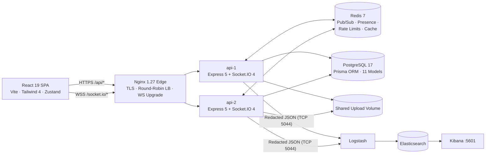

# ChatNow — Real-Time Messaging Platform

A production-grade, distributed real-time messaging platform built with **React 19 + Vite 8 + TypeScript + Tailwind CSS 4**, **Node.js + Express 5 + Socket.IO 4**, **PostgreSQL 17 (Prisma ORM)**, **Redis 7 (`@socket.io/redis-adapter`, presence, rate limiting, caching)**, **Nginx multi-instance load balancing**, and an **ELK Stack (Elasticsearch, Logstash, Kibana)** observability pipeline.

> **Honest security disclosure:** ChatNow encrypts all network traffic in transit using **HTTPS / WSS (TLS 1.2/1.3)**. It does **not** claim end-to-end encryption (E2EE) — the server can read message content to provide full-text search, delivery tracking, and moderation.

---

## Architecture Overview



---

## Key Features

- **Hardened Authentication & Sessions**: Argon2id password hashing (NIST SP 800-63B length policy), short-lived 15-min HS256 JWT stored strictly in JS memory (never `localStorage`), opaque 256-bit `HttpOnly; SameSite=Strict` refresh cookie stored as SHA-256 hash, single-flight silent refresh interceptor, refresh-token rotation with **token-family reuse/theft detection**, active sessions management, and instant WebSocket revocation on logout / password change.
- **Private & Group Messaging**: Instant 1:1 (`directKey` race-safe uniqueness) and group messaging with `OWNER` / `ADMIN` / `MEMBER` RBAC, automatic ownership transfer on owner leave, replies, 15-minute message editing, soft deletion, emoji picker & reactions, keyset cursor pagination, and `?around=` jump-to-message.
- **Real-Time Engine (Socket.IO)**: WebSocket-only transport (no sticky sessions needed behind Nginx), server-assigned rooms (`user:{id}`, `conversation:{id}`), live typing indicators with 6 s auto-expiry, multi-tab Redis presence with 30 s heartbeat TTL + 5 s offline grace period, `sent → delivered → read` receipt ticks, offline delivery flush, and automatic reconnection catch-up.
- **Search, Notifications & Secure Uploads**: PostgreSQL `pg_trgm` user search + `to_tsvector` full-text message search (membership-gated), durable in-app & Browser Notification API alerts, magic-byte file sniffing (rejecting spoofed HTML/SVG/executables), random UUID storage keys outside webroot, and membership-authorized blob downloads.
- **Distributed Scale & Observability**: Official `@socket.io/redis-adapter` bridging `api-1` and `api-2`, Redis-backed shared REST & Socket.IO rate limiting, Pino + Logstash defense-in-depth log redaction (never logs passwords, JWTs, cookies, or message bodies), and pre-built Kibana saved searches.
- **Modern Responsive SaaS UI**: Custom light/dark/system design system (no-flash bootstrap), responsive 3-pane desktop layout & mobile navigation, skeleton loaders, empty/error states, `Ctrl+K` quick search, Profile, and Settings screens.

---

## Documentation Index

| Document | Contents |
|---|---|
| [docs/01-architecture.md](docs/01-architecture.md) | System overview, multi-server Redis Pub/Sub sequence diagram, design decisions, repository layout |
| [docs/02-database.md](docs/02-database.md) | 11-model PostgreSQL ER diagram, indexes, cascade rules, keyset pagination |
| [docs/03-rest-api.md](docs/03-rest-api.md) | Complete REST API contract, DTOs, error envelope, rate limits, group RBAC matrix |
| [docs/04-socket-events.md](docs/04-socket-events.md) | Socket.IO handshake, client/server event contracts, tick lifecycle, presence & reconnection |
| [docs/05-security.md](docs/05-security.md) | All 18 cybersecurity controls mapped to code, Phase 6 audit findings & fixes |
| [docs/06-testing.md](docs/06-testing.md) | Unit, integration, multi-instance Redis, security & Playwright E2E test matrix & results |
| [docs/07-deployment.md](docs/07-deployment.md) | Free-tier cloud deployment (Vercel + Render + Neon + Upstash) & self-hosted Docker TLS guide |

---

## Technology Stack

| Layer | Technologies |
|---|---|
| **Frontend** | React 19, Vite 8, TypeScript 5.8, Tailwind CSS 4, React Router 7, Zustand 5, Axios, Socket.IO Client 4, Lucide React |
| **Backend** | Node.js 24 LTS, Express 5, Socket.IO 4, `@socket.io/redis-adapter`, Prisma 6, Zod 4, Argon2, JWT, Helmet, Pino, Multer |
| **Data & Infra** | PostgreSQL 17, Redis 7, Docker & Docker Compose v2, Nginx 1.27, Elasticsearch / Logstash / Kibana 8.17 |
| **Testing** | Vitest 5, Supertest, React Testing Library, Playwright |

---

## Prerequisites & Local Setup (Windows 11 PowerShell)

### Prerequisites
- **Node.js 22+** (verified on `v24.21.0` / `npm 11.19.0`)
- **Git**
- **Docker Desktop** (with WSL 2 backend enabled and running)

### 1. Environment Configuration
Copy the templates (on a fresh clone) and fill in the secret values (`.env` files are git-ignored):

```powershell
Copy-Item .env.example .env
Copy-Item backend\.env.example backend\.env
Copy-Item frontend\.env.example frontend\.env
```

Generate strong secrets in PowerShell:
```powershell
# POSTGRES_PASSWORD (put the same value in root .env and backend/.env DATABASE_URL)
node -e "console.log(require('crypto').randomBytes(24).toString('base64url'))"

# JWT_ACCESS_SECRET (put in backend/.env)
node -e "console.log(require('crypto').randomBytes(48).toString('base64url'))"
```

> **Port notes:** Docker PostgreSQL uses host port **5434** (native PostgreSQL servers already use 5432 and 5433 on this machine), Redis uses **6379**, Backend dev uses **4000**, Frontend dev uses **5174**, Nginx multi-instance uses **8080** (`api-1` on **4001**, `api-2` on **4002**), and Kibana uses **5601**.

### 2. Run in Local Development Mode (Hot Reload)

```powershell
# Terminal 1 — Start PostgreSQL + Redis, run migrations, seed demo accounts, start API
cd c:\Projects\Chatbot
docker compose up -d postgres redis
cd backend
npm install
npx prisma migrate deploy
npm run seed
npm run dev
```

```powershell
# Terminal 2 — Start React + Vite frontend (http://localhost:5174)
cd c:\Projects\Chatbot\frontend
npm install
npm run dev
```

### 3. Run Full Multi-Instance Stack (`api-1` + `api-2` + Nginx) + Optional ELK

```powershell
cd c:\Projects\Chatbot

# Full stack (http://localhost:8080, direct api-1 on :4001, api-2 on :4002)
docker compose --profile full up -d --build

# Full stack + ELK observability (Kibana at http://localhost:5601 — needs ~3-4 GB RAM)
docker compose --profile full --profile elk up -d --build
```

Verify both instances and Nginx load balancer:
```powershell
Invoke-RestMethod http://localhost:4001/api/health
Invoke-RestMethod http://localhost:4002/api/health
Invoke-RestMethod http://localhost:8080/api/health
```

Import the Kibana saved searches (once Kibana reports ready, about a minute after start), either through **Stack Management → Saved Objects → Import** with `infrastructure\elk\kibana\chatnow-saved-objects.ndjson`, or from the repository root:

```powershell
curl.exe -X POST "http://localhost:5601/api/saved_objects/_import?overwrite=true" -H "kbn-xsrf: true" --form file=@infrastructure/elk/kibana/chatnow-saved-objects.ndjson
```

Logs appear in Kibana only for events that happen after Logstash is running; the API reconnects to Logstash on its own every 5 seconds. Kibana usage telemetry is disabled in `docker-compose.yml`.

---

## Running Tests

```powershell
# Backend unit & security tests (no Docker needed — 107 tests)
cd c:\Projects\Chatbot\backend
npm run typecheck
npm test

# Backend integration, Socket.IO, multi-instance Redis & security tests (needs Postgres + Redis)
npm run test:integration

# Frontend unit & component tests (no Docker needed — 14 tests)
cd c:\Projects\Chatbot\frontend
npm run typecheck
npm test
npm run build

# Playwright multi-user E2E tests (needs running app)
npx playwright install chromium
npm run test:e2e
```

---

## Live Demonstration & Screenshot Walkthrough

Follow this script for portfolio demos or interviews:

1. **Dual-Window Real-Time Messaging**: Open `http://localhost:8080` (or `:5174`) in a regular browser window and an Incognito window. Register/log in as **Alice** and **Bob**.
2. **Auth & Security Proof**: Open DevTools → Application → confirm **Cookies** holds `chatnow_rt` (`HttpOnly`) and **Local Storage** contains zero JWT tokens. Reload both windows — both stay signed in seamlessly.
3. **Instant Chat, Typing & Receipts**: Start typing as Alice to show Bob's live typing indicator; send a message and watch ticks advance `✓ (sent) → ✓✓ (delivered) → blue ✓✓ (read)`. Reply, react with emojis, edit within 15 minutes, attach an image, and reload to prove PostgreSQL persistence.
4. **Group RBAC**: Create a group with Alice, Bob, and Carol. Show Bob (MEMBER) cannot rename or remove members; promote Bob to ADMIN as Alice (OWNER); leave as Alice and verify ownership transfers automatically to Bob.
5. **Multi-Instance Redis Proof**: With `--profile full` running, open Alice at `http://localhost:8080` and Bob at `http://127.0.0.1:8080` (different host names keep their login cookies separate). Check which server each landed on with `docker logs chatnow-api-1-1 | findstr socket.connected` (and the same for `api-2-1`); when they are on different instances, every message and receipt between them has crossed Redis. Then `docker stop chatnow-api-1-1` mid-conversation: the client reconnects to `api-2` and chat continues. `npm run test:integration` in `backend/` proves the same automatically, including that delivery fails when the Redis adapter is disabled.
6. **ELK Log Inspection**: Open Kibana (`http://localhost:5601`) and open the **ChatNow - Authentication Events**, **WebSocket Events**, and **Message Delivery Events** saved searches — demonstrating full traceability with `[REDACTED]` sensitive fields and zero logged message content.

---

## Project Verification Status

Last verified 2026-11-19 on Windows 11 with Docker Desktop (WSL 2).

| Criterion | Verification State |
|---|---|
| Backend: 107 unit + 46 integration tests against real PostgreSQL 17 and Redis 7 | **Passing (153/153)** |
| Frontend: typecheck, production build, 14 component tests | **Passing** |
| Prisma migration on a real database, no schema drift | **Verified** |
| Two users in a browser: register, login, instant messages, typing, online / last seen, delivered → read ticks, history after reload, mobile layout | **Verified manually** |
| Full stack `--profile full`: migrate job, `api-1`, `api-2`, frontend and Nginx all healthy | **Verified** |
| Cross-server chat through Nginx: Alice's socket on `api-1`, Bob's on `api-2`; messages and read receipts cross via Redis | **Verified manually** (and by `multi-instance.test.ts`) |
| Failover: `api-1` stopped mid-chat, Alice's client reconnected to `api-2` automatically and messaging continued | **Verified manually** |
| ELK: logs from both instances in Elasticsearch; Kibana saved searches import and display; canary passwords, cookies, tokens and message text absent from every stored log | **Verified** |
| Group chats, file uploads, reactions, edit/delete in the browser | Covered by integration tests; **not yet exercised manually** |
| Playwright end-to-end suite (`npm run test:e2e`) | **Not yet run** |
| Cloud production deployment | Blueprints written (`render.yaml`, `vercel.json`, `docs/07-deployment.md`); **not yet deployed** |
