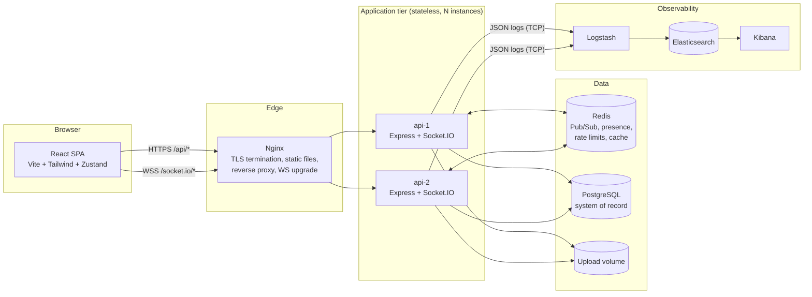
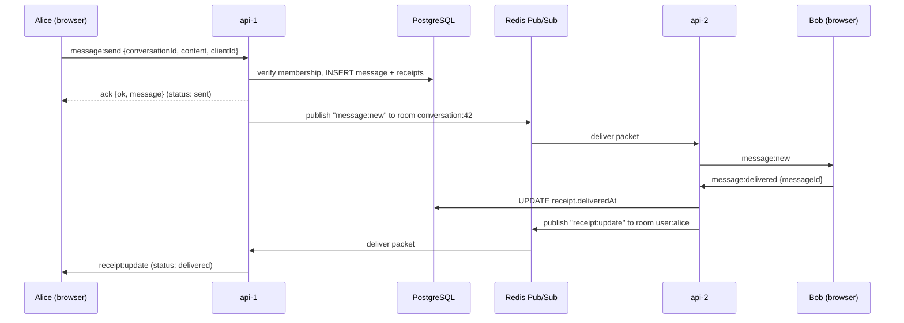

# ChatNow — Architecture

Status: Phase 1 (planning). This document is the source of truth for structure and
technology decisions. It is updated whenever a later phase changes a decision.

## 1. System overview



### Why each piece exists

| Component | Job | Why not something simpler |
|---|---|---|
| **React SPA** | All UI. Talks REST for request/response work and Socket.IO for anything pushed. | — |
| **Nginx** | One public origin for the SPA, `/api` and `/socket.io`. Terminates TLS, load-balances the API instances. | One origin means the refresh cookie can be `SameSite=Strict` and no cross-origin CORS is needed in production. |
| **API instances** | Express (REST) and Socket.IO (WebSocket) in the same Node process. Hold **no** durable state. | Stateless instances are what make "run two of them" possible. |
| **PostgreSQL** | The only durable store: users, conversations, messages, receipts, audit log. | Messages are relational (who is in which conversation, who read what). |
| **Redis** | Shared *ephemeral* state between instances: Pub/Sub for Socket.IO, presence, typing, rate-limit counters, small caches. | In-process memory would be invisible to the other instance. |
| **ELK** | Logstash receives structured logs, Elasticsearch indexes them, Kibana queries them. | Two instances means two log streams; you need one searchable place. |

## 2. The multi-server problem, from the basics

A WebSocket is a long-lived TCP connection between **one** browser and **one** server
process. If Alice is connected to `api-1` and Bob to `api-2`, then `api-1` has no socket
for Bob — calling `io.to("user:bob").emit(...)` on `api-1` reaches nobody.

The fix is the official **`@socket.io/redis-adapter`**. Every instance subscribes to a
Redis Pub/Sub channel. When any instance emits to a room, the adapter also publishes the
packet to Redis; every other instance receives it and delivers it to *its own* local
sockets in that room.



How this is demonstrated and tested: Docker Compose runs `api-1` and `api-2`. Besides
being reachable through Nginx, each is also published on its own host port, so an
integration test connects user A **directly to api-1** and user B **directly to api-2**
and asserts the message arrives. Stopping Redis must make that test fail — that is the
proof Redis is doing the work.

## 3. Key design decisions

Each row is a place where the brief was open; the default chosen is in bold.

| Topic | Decision | Reasoning |
|---|---|---|
| Language | **TypeScript** on both sides | Shared event/DTO types keep the frontend and backend contracts from drifting. |
| Password hashing | **Argon2id** (`argon2` package) | Current OWASP first choice; memory-hard, so GPU cracking is expensive. bcrypt is the fallback if the native build fails on a deploy host. |
| Access token | **JWT, 15 min, HS256, kept in JS memory only** | Never in `localStorage`, so an XSS bug cannot read a long-lived credential from disk. |
| Refresh token | **Opaque 256-bit random value in an `HttpOnly; Secure; SameSite=Strict` cookie; only its SHA-256 hash is stored**; rotated on every use; reuse of an old token revokes the whole session family | A stolen DB dump contains no usable tokens. Reuse detection turns token theft into a forced logout. |
| Sending messages | **Socket event with acknowledgement** (primary) and `POST /messages` (same service function) | The ack gives the sender an immediate "sent" confirmation; REST exists for testing and non-socket clients. Both paths run identical authorization. |
| Rooms | `user:{id}` (all of a user's tabs/devices) and `conversation:{id}` | The **server** joins sockets to rooms from DB membership at connect time. Clients can never ask to join a room. |
| Presence | Redis: per-user set of live socket ids with heartbeat TTL; `lastSeenAt` persisted to Postgres on last disconnect | Correct across instances and across multiple tabs (online until the *last* socket closes). TTL cleans up after a crashed instance. |
| Receipts | One `MessageReceipt` row per (message, recipient) with `deliveredAt` / `readAt` | Works identically for 1:1 and groups; the sender's tick is derived (all delivered → ✓✓, all read → blue). |
| 1:1 uniqueness | `Conversation.directKey = "<smallerUserId>:<largerUserId>"` with a unique index | Makes "two users have at most one direct chat" a database guarantee, safe under concurrent requests. |
| Message search | **PostgreSQL full-text search** (`tsvector` + GIN index), always joined through the caller's memberships | No extra service; authorization is part of the query. Elasticsearch is reserved for logs. |
| Deletion | Soft delete (`deletedAt`, content blanked) | Keeps reply chains and receipts consistent; the UI shows "message deleted". |
| File uploads | `multer` to a non-web-served volume; size cap, extension + MIME allow-list, **magic-byte sniffing**, random stored names; downloads go through an authorized route | The client-supplied filename and Content-Type are never trusted. S3-compatible storage is the documented production swap. |
| Validation | **Zod** schemas for every REST body/query and every socket payload | One schema library for both transports. |
| Logging | **pino** JSON to stdout, plus a TCP transport to Logstash | Redaction list is enforced in the logger config: passwords, tokens, cookies, `Authorization`, and message `content` are never logged. |
| Rate limiting | `express-rate-limit` with a Redis store; separate token-bucket for socket events | Limits must be shared across instances or they are trivially bypassed by load balancing. |
| Encryption claims | **TLS in transit only. ChatNow does not claim end-to-end encryption.** | The server can read message content. This is stated in the security docs and README. |

## 4. Technology versions

Exact versions are pinned in `package.json` / Compose files at install time and recorded
here once each phase is verified.

| Layer | Choice |
|---|---|
| Runtime | Node.js 24 LTS (installed: 24.21.0), npm 11 |
| Backend | Express 5, Socket.IO 4, Prisma ORM, Zod, pino, helmet, argon2, jsonwebtoken, multer |
| Frontend | React 19, Vite, TypeScript, Tailwind CSS 4, React Router, Zustand, Axios, socket.io-client, lucide-react, emoji-picker-react |
| Data | PostgreSQL 17, Redis 7 |
| Infra | Docker Desktop (WSL2 backend), Docker Compose v2, Nginx 1.27, Elasticsearch / Logstash / Kibana 8.x |
| Tests | Vitest + Supertest (backend), Vitest + Testing Library (frontend), Playwright (end-to-end, two browser contexts) |

## 5. Repository layout

```
Chatbot/                          repository root (the "chatnow" monorepo)
├── backend/
│   ├── prisma/
│   │   ├── schema.prisma         data model
│   │   ├── migrations/           generated SQL migrations (committed)
│   │   └── seed.ts               demo users for local development
│   ├── src/
│   │   ├── config/               env parsing (Zod), prisma, redis, logger
│   │   ├── middleware/           authenticate, authorize, validate, rateLimit, errorHandler
│   │   ├── routes/               URL → controller wiring only
│   │   ├── controllers/          HTTP in/out; no business logic
│   │   ├── services/             business logic + authorization rules (shared by REST and sockets)
│   │   ├── sockets/              io setup, auth handshake, event handlers, presence
│   │   ├── validators/           Zod schemas
│   │   ├── utils/                tokens, hashing, errors, file sniffing
│   │   ├── app.ts                builds the Express app (importable by tests)
│   │   └── server.ts             process entry: HTTP + Socket.IO + graceful shutdown
│   ├── tests/                    unit/, integration/, socket/
│   └── Dockerfile
├── frontend/
│   ├── src/
│   │   ├── assets/
│   │   ├── components/           ui/ (design system), chat/, sidebar/, details/
│   │   ├── layouts/              AuthLayout, AppLayout (3-pane)
│   │   ├── pages/                Login, Register, Chat, Profile, Settings
│   │   ├── hooks/
│   │   ├── services/             axios instance + refresh interceptor, socket client, API modules
│   │   ├── store/                Zustand slices: auth, conversations, messages, presence, ui
│   │   ├── contexts/             Theme
│   │   └── utils/
│   ├── e2e/                      Playwright specs
│   └── Dockerfile
├── infrastructure/
│   ├── nginx/                    nginx.conf (dev LB) and TLS variant
│   └── elk/                      logstash pipeline, kibana saved objects
├── docs/                         architecture, database, API, sockets, security, testing, deployment
├── docker-compose.yml            postgres, redis, api-1, api-2, nginx  (+ `elk` profile)
├── .env.example
└── README.md
```

The rule that keeps this maintainable: **controllers and socket handlers never touch
Prisma directly**. They validate input, call a service, and shape the output. Every
authorization rule therefore lives in exactly one place and is enforced on both
transports.

## 6. Implementation plan

Each phase ends with a verification gate. A phase is not closed until its gate passes.

| Phase | Work | Verification gate |
|---|---|---|
| **1. Planning** | This document, ER design, REST contract, Socket.IO contract | Documents reviewed |
| **2. Backend foundation** | Compose for Postgres + Redis; Express skeleton; env validation; Prisma schema + first migration; register / login / refresh / logout; users + profile; error handling, helmet, CORS, rate limits | `prisma migrate` applies cleanly; auth integration tests pass (including refresh rotation and reuse detection); `/api/health` reports DB + Redis up |
| **3. Frontend foundation** | Vite + Tailwind design system (tokens, light/dark); login + register; protected routes; silent refresh; 3-pane app shell with loading / empty / error states | Register → login → reload stays signed in → logout, verified in a real browser at desktop and mobile widths |
| **4. Real-time messaging** | Socket auth; conversations (direct + group, roles); messages (send, edit, delete, reply, react, paginate); typing; presence; delivered/read receipts; unread counts; notifications; search; uploads; block/unblock | Two browser sessions as two users: instant delivery, persistence after refresh, ticks progress sent → delivered → read, typing and presence update, a non-member is refused on REST and on sockets |
| **5. Advanced infrastructure** | Redis adapter; `api-1` + `api-2` behind Nginx; Dockerfiles; ELK pipeline + Kibana dashboards | Cross-instance test passes and fails when Redis is stopped; `docker compose up` brings every service healthy; auth / socket / delivery events visible in Kibana with no secrets or message content |
| **6. Security and testing** | Authorization-boundary tests, socket-event abuse tests, concurrency tests, upload tests, Playwright journeys, dependency audit, security document | Full test suite green; results recorded in `docs/` |
| **7. Deployment** | Production builds, migration-on-deploy, HTTPS/WSS, deployment guide, README with screenshots | Deployed instance passes the success-criteria checklist |

### Deployment targets (decided in Phase 7, listed now so nothing is a surprise)

| Need | Free-tier option | Limits to know about |
|---|---|---|
| Frontend | Vercel, Netlify or Cloudflare Pages | Generous; static hosting only |
| Backend (WebSockets) | Render free web service | Sleeps after ~15 min idle (cold start ≈ 1 min); a single free instance, so the multi-instance demo stays local/Docker |
| PostgreSQL | Neon free plan | Storage and compute-hour caps; scales to zero when idle |
| Redis | Upstash free plan | Daily command cap; Pub/Sub traffic counts toward it |
| ELK | **None suitable** | Elasticsearch needs ≥ 1–2 GB RAM. Elastic Cloud is a 14-day trial, then paid. ELK is demonstrated locally in Docker; production uses the host's log stream. |

Free-tier terms change; they are re-checked against the providers' current pricing pages
in Phase 7 before anything is recommended as final.
