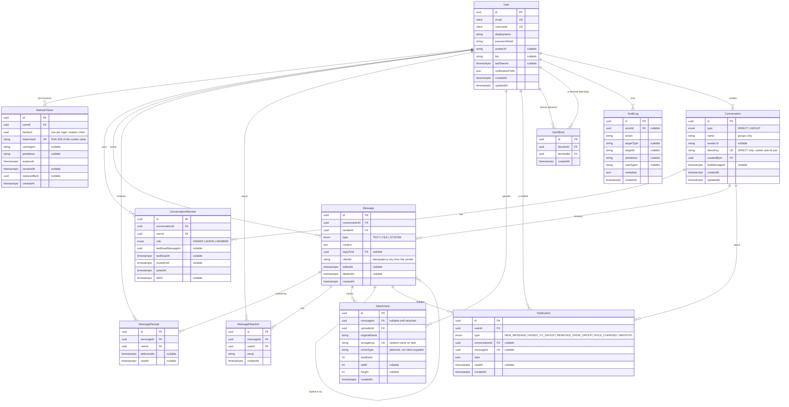

# ChatNow — Database Design

PostgreSQL, managed through Prisma migrations. All primary keys are UUIDs (generated by
the database) so ids are not guessable or enumerable. All timestamps are `timestamptz`
in UTC.

## ER diagram



## Purpose of each model

| Model | Purpose |
|---|---|
| **User** | Account and public profile. `email` and `username` use the `citext` type so uniqueness is case-insensitive (`Alice` and `alice` cannot both register). `passwordHash` holds an Argon2id hash and is never selected by default in queries that return users to clients. |
| **RefreshToken** | One row per issued refresh token — this is the session table. Storing only a hash means a database leak yields no usable tokens. `familyId` groups every token descended from one login; presenting an already-rotated token revokes the entire family (theft detection). Also powers "active sessions" and "log out everywhere". |
| **Conversation** | A chat thread, either `DIRECT` (exactly two members) or `GROUP`. `directKey` is the mechanism that guarantees a pair of users has at most one direct conversation. `lastMessageAt` is denormalised so the sidebar can be sorted without scanning messages. |
| **ConversationMember** | Join table between users and conversations, and the **authorization record**: every read or write of a conversation checks for a row here with `leftAt IS NULL`. Carries the group role and the per-user read cursor used to compute unread counts. |
| **Message** | A single message. `replyToId` self-references for replies. `clientId` is a UUID generated by the sender so a retry after a dropped connection does not create a duplicate. Soft-deleted via `deletedAt`. Full-text search uses an expression index on `to_tsvector('simple', content)` rather than a stored column. |
| **MessageReceipt** | Per-recipient delivery and read state. Created for every member except the sender when a message is stored. The sender's tick state is derived from these rows. |
| **MessageReaction** | One emoji reaction by one user on one message. |
| **Attachment** | Metadata for an uploaded file. The bytes live on disk/object storage under `storageKey`; the database never stores file contents. Uploaded first (unattached), then linked when the message is sent. |
| **Notification** | Durable in-app notification so that events that happened while a user was offline are available when they return. Browser notifications are generated client-side from socket events and are not stored separately. |
| **UserBlock** | Directed block relationship. A block in either direction prevents new direct conversations and new direct messages; it also hides presence. |
| **AuditLog** | Append-only security trail: registrations, logins (success and failure), token-reuse detections, password changes, group membership and role changes, blocks, message deletions by admins. Contains identifiers and metadata only — never credentials or message content. |

## Constraints and indexes

| Table | Constraint / index | Supports |
|---|---|---|
| User | `UNIQUE(email)`, `UNIQUE(username)` | Login lookup, registration conflicts |
| User | GIN trigram indexes on `username::text` and `displayName` | `GET /users/search` with partial matches |
| RefreshToken | `UNIQUE(tokenHash)` | Refresh lookup |
| RefreshToken | `INDEX(userId)`, `INDEX(familyId)`, `INDEX(expiresAt)` | Session list, family revocation, cleanup job |
| Conversation | `UNIQUE(directKey)` | One direct chat per user pair, race-safe |
| Conversation | `INDEX(lastMessageAt DESC)` | Sidebar ordering |
| ConversationMember | `UNIQUE(conversationId, userId)` | No duplicate membership |
| ConversationMember | `INDEX(userId, leftAt)` | "My conversations", the hot authorization check |
| Message | `INDEX(conversationId, createdAt DESC, id DESC)` | Keyset pagination of history |
| Message | `UNIQUE(senderId, clientId)` | Idempotent send |
| Message | `INDEX(replyToId)` | Reply lookups |
| Message | GIN on `to_tsvector('simple', content)` | Message search |
| MessageReceipt | `UNIQUE(messageId, userId)` | One receipt per recipient |
| MessageReceipt | `INDEX(userId, readAt)` | Unread counts, bulk mark-as-read |
| MessageReaction | `UNIQUE(messageId, userId, emoji)` | A user reacts once per emoji |
| Attachment | `UNIQUE(storageKey)`, `INDEX(messageId)` | File lookup, shared-media panel |
| Notification | `INDEX(userId, readAt, createdAt DESC)` | Notification list and badge |
| UserBlock | `UNIQUE(blockerId, blockedId)`, `INDEX(blockedId)` | Block checks in both directions |
| UserBlock | `CHECK(blockerId <> blockedId)` | Cannot block yourself |
| AuditLog | `INDEX(actorId, createdAt DESC)`, `INDEX(action, createdAt DESC)` | Investigations |

## Cascade behaviour

| Parent deleted | Child | Behaviour | Why |
|---|---|---|---|
| User | RefreshToken, ConversationMember, MessageReceipt, MessageReaction, Notification, UserBlock | `CASCADE` | Belong entirely to that user |
| User | Message (`senderId`), Attachment (`uploaderId`) | `RESTRICT` | Deleting an account must not silently erase other people's conversation history. Account deletion is implemented as anonymisation, not a row delete. |
| User | AuditLog (`actorId`) | `SET NULL` | The audit trail outlives the account |
| Conversation | ConversationMember, Message, Notification | `CASCADE` | No meaning without the conversation |
| Message | MessageReceipt, MessageReaction, Attachment, Notification | `CASCADE` | Only reached by hard deletes (conversation removal); normal deletes are soft |
| Message | Message (`replyToId`) | `SET NULL` | A reply survives the removal of its parent |

## Notes on things Prisma does not express natively

Prisma's schema language cannot declare extensions (without a preview feature),
expression indexes or `CHECK` constraints. Four things are therefore hand-written in the
first migration (`backend/prisma/migrations/20261116000000_init/migration.sql`) and
commented there:

- `CREATE EXTENSION citext` and `pg_trgm`, at the top, before any table uses them.
- The username trigram index, on `"username"::text` because `gin_trgm_ops` does not
  accept `citext`. User search is raw SQL so that it uses exactly this expression.
- The message full-text index on `to_tsvector('simple', "content")`. An expression index
  was chosen over a generated column because Prisma repeatedly tries to "fix" generated
  columns it did not create.
- The `UserBlock` self-block `CHECK` constraint.

The migration SQL was generated offline with `prisma migrate diff` and has **not yet been
applied to a real PostgreSQL** (Docker was not installed when it was written). Whether
`prisma migrate dev` reports drift for the two expression indexes is checked the first
time the database is up.

## Pagination

Message history uses **keyset (cursor) pagination**, not `OFFSET`:

```
WHERE conversationId = $1 AND (createdAt, id) < ($cursorCreatedAt, $cursorId)
ORDER BY createdAt DESC, id DESC
LIMIT 30
```

`OFFSET 5000` makes the database read and discard 5,000 rows; a keyset query jumps
straight to the right place in the index and stays fast however deep the user scrolls.
It is also stable when new messages arrive while the user is paging.
